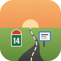

# Route du temps

Application web qui affiche votre **Google Agenda le long d'une route animée** : chaque rendez-vous devient un panneau au bord de la route, et l'on avance dans les semaines à venir en voiture, à trottinette, à vélo ou à pied.

👉 **Ouvrir l'application :** https://jfesteoule.github.io/agenda-jf/
👉 **Essayer sans compte (agenda fictif) :** https://jfesteoule.github.io/agenda-jf/?demo

## Fonctions

- Vos agendas Google, y compris ceux partagés avec vous : le vôtre à droite de la route, un agenda partagé à gauche.
- Panneaux classiques, autoroute ou randonnée, avec photos et vidéos jointes aux événements (Google Drive).
- Ajout d'un événement et d'une photo depuis l'application.
- Bornes des jours, portiques des mois, week-ends, jours fériés et vacances scolaires (zone A, B ou C).
- Vues conduite, 30° et 45°, vue conducteur, mode nuit (phares, feux arrière, frontale), saisons du paysage.
- « Retour dans le passé » : la même route parcourue en remontant le temps.
- Musique : Spotify, YouTube ou radio en direct, qui démarre et s'arrête avec la route.
- Réglages retrouvés sur tous vos appareils, installation sur l'écran d'accueil et plein écran sur smartphone.

## Confidentialité

L'application fonctionne entièrement dans le navigateur : elle n'a pas de serveur, et les données de votre compte Google ne sont envoyées nulle part ailleurs que chez Google.

- [Règles de confidentialité](https://jfesteoule.github.io/agenda-jf/confidentialite.html)
- [Conditions d'utilisation](https://jfesteoule.github.io/agenda-jf/conditions.html)

## Technique

- Un seul fichier `index.html` (HTML, CSS et JavaScript, sans framework), rendu en perspective sur un canvas 2D.
- API Google : Identity Services, Calendar, Drive et Picker.
- Hébergement : GitHub Pages ; application installable (manifeste et service worker).

## Licence

© 2023-2026 jfesteoule — tous droits réservés (voir [LICENSE](LICENSE)).
